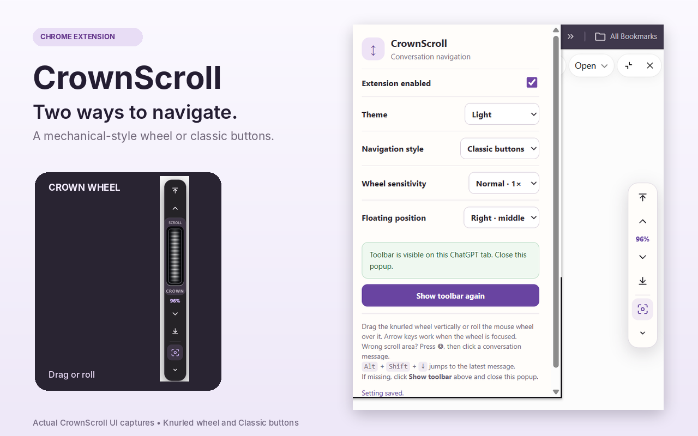
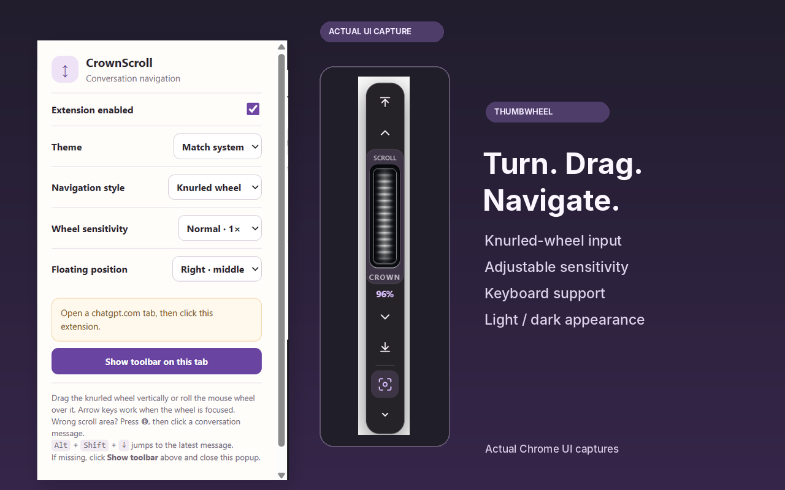
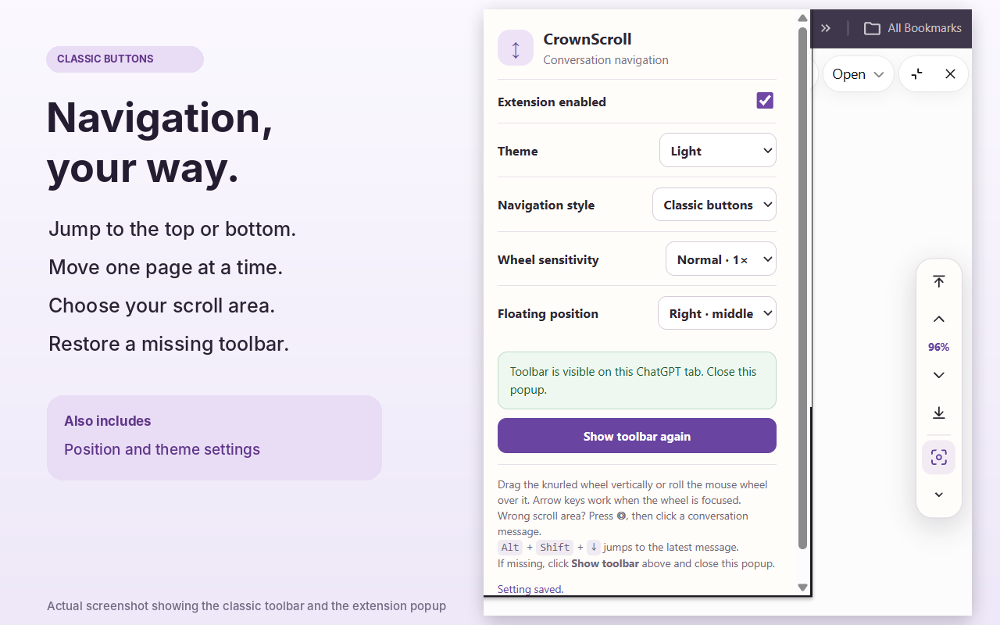

# CrownScroll

**Navigate long ChatGPT conversations with a floating crown-style thumbwheel.**

CrownScroll is a lightweight Google Chrome extension that adds a compact floating navigation toolbar to ChatGPT. Switch between the **knurled thumbwheel** and **classic buttons**, jump to the top or bottom of a conversation, and select the correct scroll area when a page layout changes.



> **Release:** v1.3.0 · Manifest V3 · Chrome/Chromium · Independent third-party project, not affiliated with or endorsed by OpenAI.
>
> **Status:** Local automated checks passed during development. Compatibility on every ChatGPT update is not guaranteed. Chrome Web Store publication is pending.

## Features

- **Crown wheel:** vertical, ribbed thumbwheel; rotate with the mouse wheel, drag vertically, or use arrow keys while focused.
- **Classic mode:** top, bottom, page up and page down buttons, with a scroll-position percentage.
- **Bidirectional feedback:** the position indicator updates as the conversation scrolls.
- **Recovery:** use **Show toolbar on this tab** if the controls disappear.
- **Manual target picker:** point the extension at the intended conversation if automatic detection picks the wrong scroll area.
- **Preferences:** light, dark or system theme; toolbar placement; wheel sensitivity; minimized state.
- **Keyboard shortcut:** `Alt + Shift + ↓` to reach the most recent conversation content (and `Alt + Shift + ↑` to jump up) outside text-editable controls.
- **Local operation:** no extension account, external analytics, or developer-operated network service in v1.3.

## Screenshots

| Crown wheel | Classic controls |
| --- | --- |
|  |  |

The graphics above arrange real interface captures; they are not live full-browser screenshots.

## Install in Chrome (developer mode)

1. Download this repository as a ZIP, **extract it**, and locate the folder containing `manifest.json`.
2. In Chrome, open `chrome://extensions` and enable **Developer mode**.
3. Choose **Load unpacked** and select that folder.
4. Open or refresh `https://chatgpt.com`.
5. Click the CrownScroll toolbar icon. If needed, select **Show toolbar on this tab**.
6. Choose **Knurled wheel** or **Classic buttons** in settings.

If you previously installed ChatFlow Navigator, disable it first to avoid duplicate floating controls.

**Important:** Native ChatGPT desktop applications do not support this Chrome extension. The extension does not fix missing or unrendered ChatGPT messages; it navigates the scrollable content available in the browser.

## How it works

The content script identifies a likely conversation scroll container and inserts a floating toolbar. The popup reads settings from `chrome.storage.local` and can restore the content script through `chrome.scripting.executeScript` when necessary. The script runs only on declared ChatGPT web origins. No remote JavaScript is loaded.

Permissions are explained in [Privacy](PRIVACY.md) and [Architecture](docs/ARCHITECTURE.md).

## Develop and test

Requires Node.js 18+ for the included unit tests. There are no runtime npm dependencies.

```bash
node --test tests/*.test.js
node --check content.js
node --check scroll-engine.js
node --check popup.js
python3 scripts/build_release.py --output CrownScroll_Chrome_Web_Store_Upload_v1_3.zip
```

Optional browser smoke tests use Python Playwright and a local Chromium executable (configured in the scripts). They exercise a **mock page**, not the live ChatGPT website:

```bash
python3 -m pip install playwright
python3 tests/browser_smoke.py
python3 tests/thumbwheel_smoke.py
python3 tests/popup_recovery.py
```

The optional real-extension test may be blocked by local Chromium policy and must not be interpreted as a successful live-site test unless it actually passes.

## Project layout

```text
CrownScroll/
├── manifest.json             # Manifest V3 configuration
├── content.js                # Floating toolbar and interactions
├── scroll-engine.js          # Scroll-container detection
├── popup.html / popup.js      # Settings and recovery
├── assets/                    # Extension icons
├── docs/                      # Architecture, publishing, screenshots
├── tests/                     # Unit and mock-browser tests
├── scripts/build_release.py   # Store ZIP builder
├── PRIVACY.md                 # Public privacy statement
├── SECURITY.md                # Vulnerability reporting
└── README.md
```

## Help and privacy

Read the [Privacy Policy](PRIVACY.md) and [Troubleshooting guide](docs/TROUBLESHOOTING.md). Use the repository **Issues** tab to report a bug or request a feature. Do not post confidential conversation content in issues or screenshots.

## Licensing and commercial plans

**No open-source license has been granted for the code at this time.** The source is available for inspection, but you should not assume permission to redistribute or sell modified copies. See [RIGHTS.md](RIGHTS.md). This deliberately leaves licensing open while the publisher considers commercial distribution.

Copyright © 2026 CrownScroll publisher. CrownScroll is not an OpenAI product.

## Project website

The `docs/` folder includes a GitHub Pages-ready static website and a dedicated `privacy.html` page. To enable it, open repository **Settings → Pages**, select **Deploy from a branch → main → /docs**, and save. Once GitHub finishes deployment, verify both the home page and privacy URL while signed out. See [publishing instructions](docs/PUBLISHING.md).
